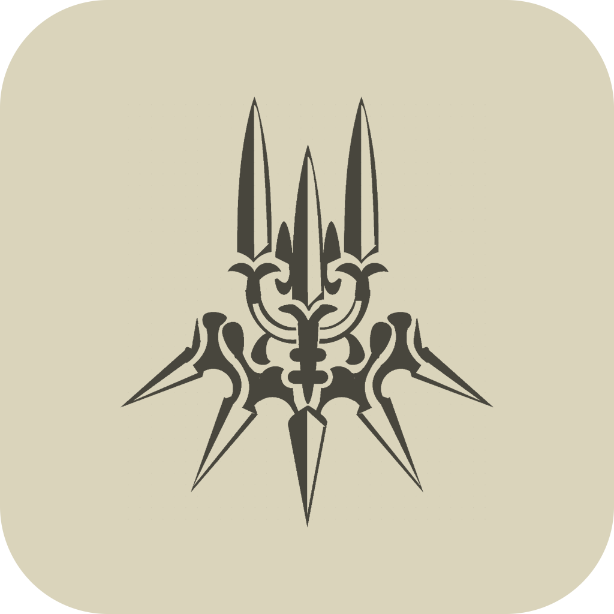

# FaRFa project



Launcher desktop pour installer, mettre à jour et lancer en un clic les jeux d'un serveur
[RomM](https://romm.app) : recomps (portages PC natifs), jeux d'émulateurs et jeux PC, avec
l'identité visuelle YoRHa de *NieR:Automata*. Windows, Linux (AppImage), Steam Deck et Mac.

Trois onglets : **Récent** (derniers jeux ajoutés), **Bibliothèque** (par console) et
**Favoris** (le cœur de RomM, partagé entre vos appareils). Les jeux s'affichent dans
leur boîte en 3D, que l'on fait tourner à la souris sur la fiche du jeu. Vos **sauvegardes**
sont copiées sur le serveur à la fin de chaque partie, pour les retrouver sur vos autres
appareils.

> Le programme garde son nom technique `FarfaLauncher` (fichiers d'installation, dossiers)
> pour que la mise à jour automatique reste transparente ; seul le nom affiché a changé.

## Pour mes amis : installation

Téléchargez le fichier de votre système dans la
[dernière release](https://github.com/Farfaboulette7/FarfaLauncher/releases/latest) :

| Système | Fichier |
|---|---|
| Windows | `FarfaLauncher_x.y.z_x64-setup.exe` |
| Linux / Steam Deck | `FarfaLauncher_x.y.z_amd64.AppImage` |

Ensuite, FaRFa project **se met à jour tout seul** : il vérifie au démarrage et propose
la nouvelle version (aussi : *Paramètres → Vérifier les mises à jour*).

### Windows : avertissement SmartScreen / antivirus

Le launcher n'est pas signé par un certificat payant : Windows affiche
« Windows a protégé votre ordinateur ». C'est normal pour un petit projet entre amis.

1. Cliquez **Informations complémentaires**, puis **Exécuter quand même**.
2. L'installation se fait dans votre dossier utilisateur, sans droits administrateur.

Si votre antivirus bloque le fichier, autorisez-le (ou ajoutez une exception) : le code
source est public et les fichiers sont compilés par GitHub à partir de ce dépôt.

### Linux / Steam Deck

```bash
chmod +x FarfaLauncher_*.AppImage
./FarfaLauncher_*.AppImage
```

Sur Steam Deck, faites-le en mode Bureau. Vous pouvez ensuite ajouter l'AppImage à Steam
(*Ajouter un jeu non-Steam*) pour le lancer depuis le mode Jeu.

### Bon à savoir

- Les jeux s'installent par défaut dans le dossier `Jeux` à côté du launcher (sinon `~/FarfaLauncher/Jeux` ; modifiable dans
  *Paramètres*). Vos sauvegardes (`save`/`saves`) ne sont jamais écrasées lors d'une mise
  à jour : elles sont même copiées dans `.farfalauncher/backups/` avant.
- **N'utilisez pas la mise à jour intégrée d'un jeu** (certains, comme gen1recomp, en
  proposent une) : c'est FaRFa project qui gère les versions, avec le badge
  « Mise à jour disponible ».
- Les mods se téléchargent dans `mods_downloads/` du jeu : à vous de les placer selon les
  instructions du mod (boutons « Ouvrir le dossier » dans l'onglet *Mods*).
- En cas de souci : *Signaler un problème* (onglet *Communauté* du jeu), ou *Paramètres →
  Cache et dépannage → Ouvrir les logs*, et envoyez le fichier du jour.

### Sauvegardes sur le serveur

- **En lançant un jeu**, le launcher compare votre sauvegarde à celle du serveur. Si elles
  diffèrent, il vous demande laquelle garder (par défaut : celle de cet appareil). Prendre
  celle du serveur remplace la vôtre ; une copie de secours est gardée dans
  `.farfalauncher/backups/` du jeu.
- **En quittant le jeu**, votre sauvegarde est envoyée sur le serveur si elle a changé.
- Le launcher cherche seul le dossier des sauvegardes (dossier `save`/`saves`, recomps
  connues). Sinon il vous le demande au premier lancement : la documentation de la recomp
  indique en général où il se trouve. Vous pouvez le changer depuis la fiche du jeu
  (*Dossier des sauvegardes…*), ou choisir de jouer sans synchroniser.

## Se connecter

1. Au premier lancement, saisissez l'adresse de votre serveur RomM (celle que vous ouvrez
   dans votre navigateur).
2. FaRFa project affiche un code et un bouton **« Ouvrir RomM »**. Connectez-vous à RomM
   dans la page qui s'ouvre, vérifiez que le code est le même, puis cliquez **Approve**.
   C'est tout : le launcher se connecte seul, et l'appareil apparaît dans votre compte RomM
   (vous pouvez le révoquer à tout moment).

Le token est rangé dans le trousseau sécurisé du système (Gestionnaire d'identification
Windows, Trousseau macOS, Secret Service sous Linux). Sous Linux sans trousseau, il va dans
un fichier que vous seul pouvez lire (`token.json`, dans le dossier des réglages).

**Méthodes de secours** (lien « Autres méthodes ») : dans RomM, *Paramètres → Client API
Tokens*, créez un token avec les droits ci-dessous, puis soit cliquez « Pair device » et
tapez le code de 8 caractères (valable 60 s), soit copiez le token et collez-le.

Droits (scopes) demandés : `me.read`, `platforms.read`, `roms.read`, `roms.user.read`,
`roms.user.write` (temps de jeu), `devices.read` (temps de jeu sur tous vos appareils),
`collections.read` et `collections.write` (favoris), `assets.read` et `assets.write`
(sauvegardes). Si vous vous êtes connecté avec une version plus ancienne, le launcher vous
demande de vous reconnecter une fois (*Paramètres → Se déconnecter*).
Détails : [docs/romm-api.md](docs/romm-api.md).

## Pour l'admin : documentation

| Document | Pour quoi |
|---|---|
| [docs/architecture.md](docs/architecture.md) | comment le launcher est construit, ce qui se passe de la connexion à la fin d'une partie |
| [docs/release.md](docs/release.md) | publier une version, pas à pas (et la clé de signature) |
| [docs/runbook.md](docs/runbook.md) | problèmes des joueurs et solutions, journaux, smoke test |
| [docs/tests.md](docs/tests.md) | lancer les tests, lire un échec de la CI |
| [docs/smoke-test.md](docs/smoke-test.md) | vérifier toute la chaîne contre les vrais serveurs |
| [docs/romm-api.md](docs/romm-api.md) | l'API RomM utilisée |
| [CLAUDE.md](CLAUDE.md), [AGENTS.md](AGENTS.md) | consignes pour un assistant IA |

Côté serveur, dans le dépôt [FarfaRomManager](https://github.com/Farfaboulette7/FarfaRomManager) :
[architecture globale](https://github.com/Farfaboulette7/FarfaRomManager/blob/master/docs/architecture.md),
[ajouter un jeu](https://github.com/Farfaboulette7/FarfaRomManager/blob/master/docs/ajouter-un-jeu.md),
[sauvegardes](https://github.com/Farfaboulette7/FarfaRomManager/blob/master/docs/sauvegarde-restauration.md),
[runbook du serveur](https://github.com/Farfaboulette7/FarfaRomManager/blob/master/docs/runbook.md),
[règles des fiches](https://github.com/Farfaboulette7/FarfaRomManager/blob/master/docs/regles-des-fiches.md).

## Pour l'admin : côté serveur

Le launcher montre **tous les jeux de RomM**, rangés par leur vraie console. Ce qu'il faut pour
les installer et les lancer vient de **FarfaRomManager** (le « gestionnaire »), à l'adresse de
RomM avec `manager` à la place du premier niveau (`romm.exemple.fr` → `manager.exemple.fr`,
modifiable dans *Paramètres → Émulateurs*). Le gestionnaire tient à jour un catalogue écrit
dans des **fiches** (une par recomp, une par émulateur) et suit seul les nouvelles versions
sur GitHub :

- **Recomp** (portage PC natif) : la fiche dit quelles entrées RomM elle fait tourner (le
  `fs_name` exact, et le `slug` RomM de la console), l'exécutable, la langue, les manettes,
  les liens… Le launcher installe sa build pour le système du joueur, plus la ROM si besoin.
  Une recomp à plusieurs jeux (Gen1recomp : Rouge, Bleu, Or…) donne une page par jeu et un
  seul programme installé.
- **Émulateur** : installé une fois dans `Emulateurs/<id>/` ; la ROM du jeu va dans
  `Roms/<console>/<jeu>/` et « Jouer » lance le jeu directement. Si un jeu a une recomp et un
  émulateur, la recomp est proposée en premier.
- **Jeux PC** (plateforme « Ordinateur ») : installés par le launcher lui-même (archives,
  installateurs GOG, Call of Duty et leurs clients), et lancés avec **Proton sous Linux**.
  Jamais par une recomp.
- **Données volumineuses** (par exemple `exefs`/`romfs` d'un jeu Switch) : une archive
  `<nom>.extract.zip` est extraite à côté de l'exécutable au lieu d'être copiée.

Ajouter un jeu ou une recomp, format des fiches : voir les liens du gestionnaire ci-dessus.

**Manettes** : lues par SDL 3, compilé dans le launcher (il faut `cmake` pour compiler).
L'onglet *Contrôles* d'un jeu installé attribue une manette à chaque joueur. Au lancement, le
launcher l'écrit dans la configuration de l'émulateur ou de la recomp, selon la clé
`manettes:` de sa fiche (`src-tauri/src/controllers.rs`). Une clé `reponse:` fait répondre le
launcher (Windows) à une question posée par l'émulateur au lancement (`src-tauri/src/dialogs.rs`).

**Boîtes 3D** : le launcher construit la boîte à partir de la face avant, de la tranche et
du dos scrapés par ScreenScraper. Il faut donc `box2d_side` (et idéalement `box2d_back`)
dans `scan.media` du `config.yml` de RomM ; sans tranche, la jaquette s'affiche à plat.

**Bruitages et musiques** : ils ne sont pas dans ce dépôt (droits non redistribuables).
Ils sont servis par FarfaRomManager sur un sous-domaine dédié, qui n'envoie un fichier qu'aux
requêtes portant un token RomM valide. Adresse par défaut : celle de RomM avec `assets` à la
place du premier niveau (`romm.exemple.fr` → `assets.exemple.fr`, sans jamais sortir du
domaine) ; modifiable dans *Paramètres → Sons*.

```
assets.json                musiques : fichiers et points de boucle
music/*.ogg
sfx/
├── OpeningMenu.wav        ouverture de l'application
├── Click.wav              clic sur un bouton
├── deplacementFocus.wav   survol d'un jeu
├── deplacementOption.wav  survol / focus d'un bouton
├── DownloadEnd.wav        téléchargement terminé
├── LancementGame.wav      lancement d'un jeu
├── retourSelection.wav    sortie de la fiche d'un jeu
└── Error.wav              erreur
```

**Musique** : à chaque lancement, un morceau d'`assets.json` est tiré au sort (jamais le
même deux fois de suite) ; seules ses deux versions sont téléchargées. Version normale dans
la bibliothèque, 8-bit sur la fiche d'un jeu : la version cible repart au même endroit de sa
boucle et les deux se croisent en fondu (0,8 s). Coupée en fondu pendant qu'un jeu tourne.
Réglages dans le menu ♪ et *Paramètres → Sons*. Le launcher garde les sons en cache (*Vider le cache* pour reprendre
une nouvelle version). Un son absent, ou un serveur injoignable, laisse simplement le
launcher muet.

**Sauvegardes** : une archive `farfa-save.zip` par jeu et par joueur, sur RomM (rangée sous
l'émulateur `farfa-project`) ou, pour une recomp, sur le gestionnaire, qui en garde
l'historique.

## Choix techniques

**Tauri 2 (Rust) + React + TypeScript + Vite.**

- **Léger** : Tauri utilise le moteur web du système (WebView2 / WebKit) ; l'exécutable
  fait quelques Mo, contre ~100 Mo pour Electron.
- **Sûr** : tout ce qui est sensible (token, réseau, fichiers, lancement de processus)
  vit côté Rust. L'interface web ne voit jamais le token et n'a pas accès au disque.
- **Réutilisation** : l'interface de NieRDeck est en React ; son style est repris et
  adapté à la souris, au clavier et aux grands écrans.
- **Mises à jour signées** intégrées (plugin updater de Tauri) et compilation
  Windows / Linux depuis GitHub Actions.
- Rust est bien outillé pour le reste du cahier des charges : téléchargement avec reprise,
  extraction zip, trousseau OS (`keyring`), suivi des processus enfants (temps de jeu).

### Arborescence

```
FarfaLauncher/
├── docs/                     Documentation (architecture, publication, dépannage, tests…)
│   └── changelog/            Notes de chaque version (texte des releases)
├── src/                      Interface React (TypeScript)
│   ├── api/backend.ts        Appels typés vers les commandes Rust
│   ├── screens/              Écrans (connexion, bibliothèque, fiche jeu, paramètres)
│   ├── components/           Éléments communs (listes, musique, messages, mises à jour…)
│   └── theme/                Thème NieR (CSS, police)
├── src-tauri/                Cœur Rust
│   └── src/
│       ├── commands/         Commandes exposées à l'interface
│       ├── romm/             Client API RomM (connexion, jeux, fichiers, temps de jeu)
│       ├── manager.rs        Catalogue de FarfaRomManager (fiches)
│       ├── install/          Téléchargement, extraction sans casse, exécutable, état
│       ├── pc/               Jeux PC (« Ordinateur »), Proton sous Linux
│       ├── play.rs           Avant et après une partie (partagé avec le Steam Deck)
│       ├── launch/           Lancement et suivi des processus du jeu
│       ├── deck.rs           Moteur sans interface pour le Steam Deck (NieRDeck)
│       └── …                 Voir docs/architecture.md
├── scripts/                  bump-version.mjs (numéro de version), smoke-test.bat/.ps1
├── .github/workflows/        CI, tests, publication des releases, smoke test quotidien
└── third_party/              Licences des ressources tierces
```

## Développement

Prérequis : Node.js 20+, Rust stable, `cmake`, et les
[prérequis Tauri](https://tauri.app/start/prerequisites/) de votre OS.

```bash
npm install
npm run tauri dev
```

Tests (détails dans [docs/tests.md](docs/tests.md)) :

```bash
npx tsc --noEmit -p .
cd src-tauri && CARGO_TARGET_DIR=target-test cargo test --lib
```

## Publier une nouvelle version (admin)

Tout est dans [docs/release.md](docs/release.md) : numéro, notes de version,
`scripts/bump-version.mjs`, tag `vX.Y.Z`, ce que fait
[`release.yml`](.github/workflows/release.yml) (tests d'abord, puis compilation Windows,
Linux, Mac et Steam Deck, signature, `latest.json`), canal bêta, annonce.

Les mises à jour sont signées par une clé privée gardée hors du dépôt
(`~/.tauri/farfalauncher.key`, secrets GitHub `TAURI_SIGNING_PRIVATE_KEY` et
`TAURI_SIGNING_PRIVATE_KEY_PASSWORD`). **Si elle est perdue, les launchers installés ne
peuvent plus se mettre à jour** : la sauvegarder comme expliqué dans
[docs/release.md §10](docs/release.md#10-la-clé-de-signature--ne-jamais-la-perdre).

## Crédits et licences

- **Police** : [Be Vietnam Pro](https://github.com/bettergui/BeVietnamPro) — SIL Open Font
  License 1.1 (`src/theme/fonts/OFL.txt`).
- **Logo** : Farfaboulette, dessin de l'auteur du projet.
- **[yorha](https://github.com/metakirby5/yorha)** de Ethan Chan — licence MIT
  (`third_party/yorha-LICENSE.txt`) : technique du fond quadrillé et du remplissage
  animé des boutons.
- **[YoRHA-UI-BetterDiscord](https://github.com/AccraZed/YoRHA-UI-BetterDiscord)** :
  palette de couleurs relevée sur ce thème. Ce projet n'ayant pas de licence, **aucun de
  ses fichiers (CSS, icônes, curseurs) n'est redistribué** ici ; les pictogrammes de
  FaRFa project sont des dessins originaux.
- *NieR:Automata* est une marque de Square Enix. Projet de fan non officiel, sans
  aucun asset du jeu.
